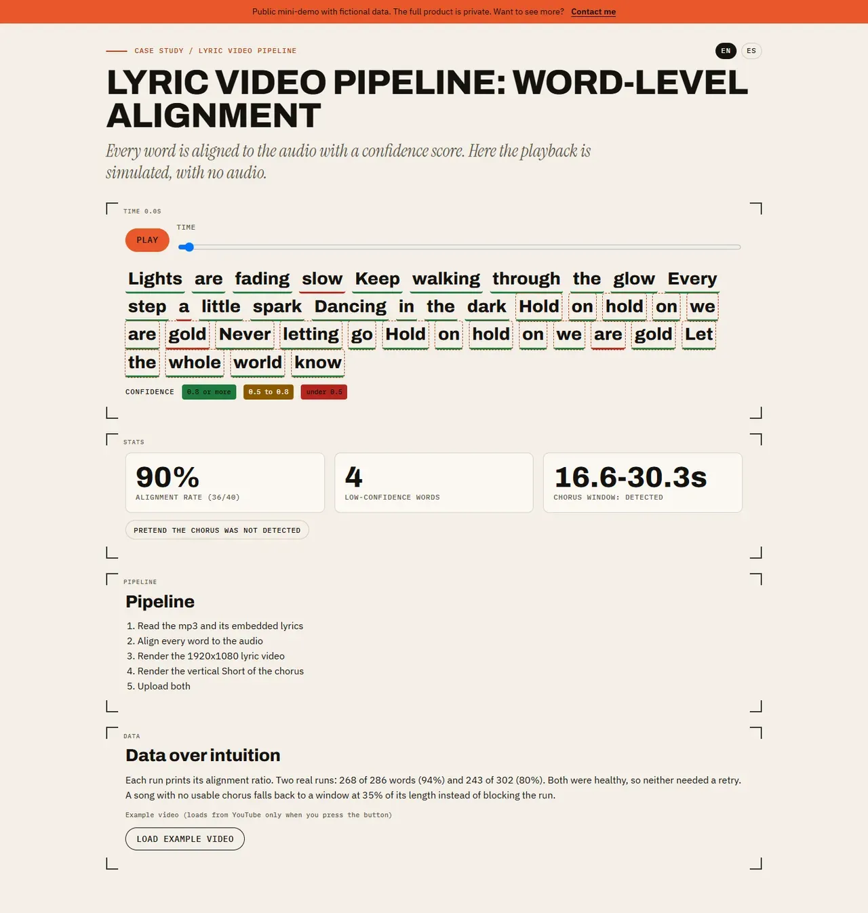

# Lyric video pipeline — word-level alignment

## Screenshots



> Public mini-demo with fictional data. The full product is private; access on request: carrerabernal@gmail.com

## Live demo

https://carrerable.github.io/lyric-sync-demo/

## What it demonstrates

- A simulated playback (no audio) of 40 fictional words, each with start, end and a confidence score; the active word is highlighted and low-confidence words are marked.
- The alignment rate (share of words with confidence of at least 0.5) and the chorus window, with a fallback at 35% of the song when no chorus is detected.
- The 5-step pipeline and a "Data over intuition" note with the figures of two real runs (268 of 286 words, 94%; 243 of 302, 80%).
- One example lyric video, loaded from YouTube only when you press the button, the same one embedded in the case study.

## What is fictional and what is real

The lyrics, timings and confidences are invented for this demo, and there is no audio. The two alignment runs quoted in the text and the 35% fallback rule come from the real, private pipeline. The code is written from scratch.

## Run locally

```bash
npm ci && npm run dev
```

Add `?lang=es` for Spanish.

## Tests

```bash
npm test
```

## How it was built

Code written with Claude Code under my specs and code review; I designed the behavior, wrote the acceptance tests and verified the result.

## Case study

https://carrerable.github.io/en/projects/lyric-videos/

## License

MIT
